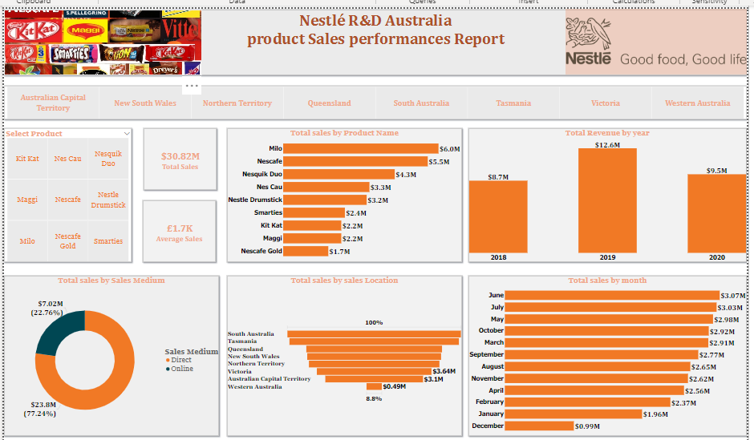

# Nestlé R&D Australia: Product Sales Performance Dashboard

A Power BI dashboard analyzing product-level sales revenue, growth, and distribution channel mix for Nestlé R&D Australia across states and time.

[View live Power BI dashboard](https://app.powerbi.com/view?r=eyJrIjoiNTY5NWFjNjktNzY1MC00OTg5LTgzMWUtM2NhMjNjYmIyYjdmIiwidCI6IjdiYWEzZDBkLTdmZjYtNDFkNS05NmQ3LTg0NzM3NzY0NjAyMSJ9) | [View portfolio](https://yusuf-data-analytics-portfolio.netlify.app/)

**Note on data:** this is a portfolio/practice analysis referencing publicly available report content associated with Nestlé R&D Australia. It is not presented as, and there is no evidence of, a real client engagement with Nestlé.

## Project overview

This dashboard tracks total sales revenue, average sale value, and product-level performance for a Nestlé R&D Australia product portfolio, broken down by product name, sales channel, state, year, and month.

This project is relevant to anyone evaluating whether I can work with a recognizable consumer product portfolio, compare individual product lines against each other, and read a multi-year growth trend alongside channel and geographic mix.

## Business questions

- Which products generate the most revenue, and which underperform?
- How has annual revenue changed year over year?
- How is revenue split between direct and online sales channels?
- Which states/territories contribute the most sales?
- Are there seasonal patterns in monthly sales?

## Key KPIs

| KPI | What it measures | Why it matters |
|---|---|---|
| Total sales revenue | Sum of all product sales across the reporting period | Headline scale of the business being analyzed |
| Average sales value | Mean value per recorded sale | Indicates typical transaction/order size |
| Sales by product name | Revenue attributed to each product | Identifies top and bottom performing products |
| Annual revenue | Total revenue by calendar year | Shows the overall growth trajectory |
| Channel split (Direct vs. Online) | Share of revenue from each distribution channel | Shows reliance on a single channel vs. diversification |
| Sales by state/territory | Revenue attributed to each Australian state or territory | Identifies which regions drive the business |
| Monthly sales pattern | Revenue by calendar month | Reveals seasonality in demand |

## Key findings

- Total sales across the reporting period reached **$30.82M**, with an average sale value of **£1.7K** per transaction.
- Milo is the leading product by revenue (**$6.0M**), ahead of Nescafe (**$5.5M**) and Nesquik Duo (**$4.3M**), while Nescafe Gold sits at the bottom of the product range (**$1.7M**) — a roughly 3.5x gap between the top and bottom performing products shown.
- Annual revenue across the three years shown was **$8.7M**, **$12.6M**, and **$9.5M**, with the middle year standing out as the strongest by a wide margin — roughly 45% higher than the other two. The exact year-to-value mapping was not fully confirmed from the chart labels, so this should be read as "one year out of three drove disproportionately more revenue" rather than a confirmed year-over-year growth trend.
- Direct sales dominate the channel mix at **$23.8M (77.24%)** versus Online at **$7.02M (22.76%)**, indicating the business is still heavily weighted toward direct distribution relative to online.
- Sales by state show a concentrated pattern, with Victoria (**~$3.64M**) and the Australian Capital Territory (**~$3.1M**) among the larger contributors and Western Australia the smallest (**~$0.49M**); South Australia appears as the top state in the location list, though the exact figure was not clearly captured.
- Monthly sales peak in the middle of the year — June ($3.07M), July ($3.03M), and May ($2.98M) are the strongest months — while December is the weakest month ($0.99M), a roughly 3x difference between the strongest and weakest months.

## Business recommendations

These are reasonable actions the findings could support; they have not been implemented and no real-world business outcome is claimed:

- **Examine what drove the standout year's revenue.** Since one year outperformed the other two by roughly 45%, understanding the driver (new distribution, a demand shift, pricing, or something else) could clarify whether that growth is repeatable.
- **Assess the online channel's growth potential.** With online at only 22.76% of revenue, there could be room to grow that channel, though this dashboard alone doesn't establish the underlying opportunity or cost of doing so.
- **Plan inventory and promotion around the June–July peak and December trough.** The scale of the seasonal swing (roughly 3x between strongest and weakest months) suggests seasonal planning could meaningfully affect stock-outs or excess inventory.
- **Investigate why Western Australia lags other states so significantly.** At roughly a sixth of Victoria's contribution, it may represent an underserved market or a genuinely smaller regional opportunity — worth confirming before assuming either.

## Dashboard preview



## Dashboard structure

Based on direct review, the report includes:

- **Overview page.** KPI cards for total sales and average sale value; a product-name filter/slicer; a horizontal bar chart of total sales by product; a bar chart of total revenue by year; a channel-mix donut chart (Direct vs. Online); a bar chart of sales by state/territory; and a bar chart of total sales by month. State/territory tabs across the top (ACT, NSW, NT, QLD, SA, TAS, VIC, WA) suggest the report may support drilling into individual states.

There may be additional pages/tabs beyond this one that have not been reviewed.

## Tools and technologies

- Power BI

Underlying Power Query and DAX logic could not be verified, since the published report does not expose the data model to a public viewer.

## Data preparation and methodology

See [`documentation/methodology.md`](documentation/methodology.md).

## Repository structure

```
/
├── README.md
├── screenshots/
│   └── README.md
└── documentation/
    └── methodology.md
```

## Business value

A product manager or commercial analyst could use this dashboard to prioritize which products to invest marketing spend behind, gauge whether channel and regional mix needs rebalancing, and plan seasonal inventory around the observed mid-year peak.

## Limitations

- **Real-world business origin not established.** This is treated as a portfolio/practice analysis referencing a Nestlé-branded product dataset; there is no evidence of an actual client relationship or that this reflects Nestlé's real sales figures.
- **Year-over-year figures not fully confirmed.** The three annual revenue values ($8.7M, $12.6M, $9.5M) were read from the chart, but their exact year labels (2018/2019/2020) were not independently confirmed.
- **State-level figures partially captured.** Victoria and ACT figures were legible; other states' exact values, and the meaning of the "100%" and "8.8%" labels on the location chart, were not confirmed.
- **Underlying data model not accessible** — DAX measures and table relationships behind the visuals cannot be reviewed from the public viewer link.
